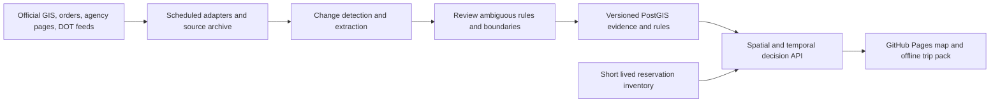

# Architecture for a trustworthy car-sleeping map

The difficult part is knowing which rule applies at a particular place and date.
The size of the place catalog is secondary. A public-land boundary, an open road,
and a camping activity icon each answer different questions.

## Recommended deployment

Keep the map on **piochelepiotr.github.io/nightjar**. Put a small ingestion worker,
read API and PostgreSQL/PostGIS behind it. Store original source documents in
object storage. Start with one worker and one database, not a cluster of services.
PostGIS supplies spatial intersections, distances and indexes; it does not decide
the legal meaning or precedence of the underlying documents.

The current application is an incremental prototype: source snapshots, a shared
Node/browser API, persistent caches, reviewed evidence and local spatial checks.
**It does not yet run a hosted PostGIS database or a comprehensive automatic
order-interpretation service.** The ten-place audit documents the remaining gaps.

## Data model

Keep these entities separate:

* **Places:** an actual parking facility, numbered pad, site group, road segment,
  or broad search area. Preserve source ID, aliases, entrance direction, vehicle
  requirements and geometry accuracy. Never turn an area centroid into a pad.
* **Sources and versions:** publisher, URL, retrieval date, publisher date, content
  hash, HTTP validators, raw document location, page/paragraph reference and license.
* **Rules:** activity (sleep inside car, park overnight, tent camp, drive, light a
  fire), authority, exact affected geometry, effective and expiry dates, vehicle
  classes, time limit, exceptions, superseding/rescinding order and review state.
* **Conditions:** road gates, snow/seasonal closures and temporary entry closures,
  with their own observation times and expiry. Access permission is not proof of
  suitable ground conditions.
* **Availability observations:** reservation inventory checked for the entire stay
  at the same compatible site. First come first served is not a live vacancy feed.
* **Coverage:** which ownership, municipal, unit, district and emergency-order
  sources have actually been checked for the area. A successful feed request does
  not establish that the publisher included every relevant order.
* **Decisions:** the evaluated point/date/vehicle/activity, result, reasons, source
  version IDs and unresolved issues. This makes each verdict reproducible.

An example answer is “Vehicle camping permitted only at numbered sites; this marker
is a site-group reference; winter gate status unresolved; occupancy unknown.” It is
not reduced to an unexplained confidence percentage.

## Collection and review

Maintain a registry of specific official publishers. Prefer GIS/services and
machine-readable feeds, then agency HTML and signed orders/PDFs. Discover source
links at the forest/district/county level as well as recreation records; the audit
found usable areas with null or unrelated activity tags.

Fetch and archive documents once. Use ETag/Last-Modified and content hashes to
detect real changes. Store a changed document as a new version rather than
overwriting the evidence that supported yesterday's decision. A source disappearing
is an investigation event, not a rescission of its rule.

An LLM can propose summaries, named exceptions and map annotations. Require exact
source references and schema validation. Conflicts, unclear scope, scanned maps
and new interpretations enter a review queue; they do not automatically become
green permission. Only a previously reviewed adapter for a stable structured feed
should publish changes automatically.

Treat authority and specificity explicitly. A broad permission can have local
exceptions; a camping ban can exempt designated sites; a fire ban does not normally
ban sleeping. Conflicting authorities or unresolved boundaries produce unknown,
not a universal “most restrictive text wins” algorithm.

Store photos/recent visitor reports separately as dated supporting observations.
They can reveal an obstruction or changed sign and trigger review. “People slept
here” does not establish legal permission. Walmart needs store-specific car-use
permission and local-law coverage, not a chain-wide RV policy.

## Refresh and caching policy

Initial targets, adjusted to publisher update frequency and rate limits:

| Data | Refresh target | Expired/offline behavior |
| --- | --- | --- |
| Ownership, road geometry, ordinary boundaries | Weekly/monthly, plus publisher changes | Retain version/date; do not imply current conditions |
| Orders and local policies | Daily change check; faster for emergency alerts | Mark coverage/check stale; retain known restrictions as last reported |
| Structured road/rest-area closures | 15–60 minutes while relevant to active trips | Remove current-open claim when freshness expires |
| Private owner permission | Stated expiry / stay date | Unknown after expiry |
| Reservable campsite inventory | On demand, about 1–5 minute cache | No current-availability claim on source failure |

Cache raw sources, parsed versions, geometry tiles and point-query decisions keyed
by rule/source versions. Precompute vector tiles and regional policy intersections;
do not ship the entire western GIS dataset inside the JavaScript bundle. Invalidate
affected areas when a relevant source changes.

Offline trip packs should contain a corridor's places, rules, evidence summaries
and geometry, each with timestamps. They must not silently extend an operating
status or reservation observation's validity. Full offline basemaps require a
tile provider/license that permits downloads.

## Evaluation and rollout

Start with thoroughly researched travel corridors, explicitly label the rest
unknown, and expand forest by forest/county by county. For each review, sample
opposite sides of boundaries, designated exceptions, private inholdings, expired
orders, seasonal road gates, car versus RV rules, and closed facilities.

Maintain independently researched destination acceptance cases and check the
browser's actual recommendations, detail summaries, sources and colors. Track
false permission, missing useful options and excessive uncertainty separately.
Never claim an audit passed simply because every candidate was hidden as unknown.

The next useful investment is systematic source/coverage registration and reviewed
rule geometry, then PostGIS and API extraction. Adding millions of unreviewed pins
would make the present accuracy problem harder to see.

Primary technical references: [PostGIS spatial predicates](https://postgis.net/docs/ST_Intersects.html),
[HTTP caching and validation](https://www.rfc-editor.org/rfc/rfc9111.html), and
[GitHub Pages static hosting](https://docs.github.com/en/pages/getting-started-with-github-pages/what-is-github-pages).
